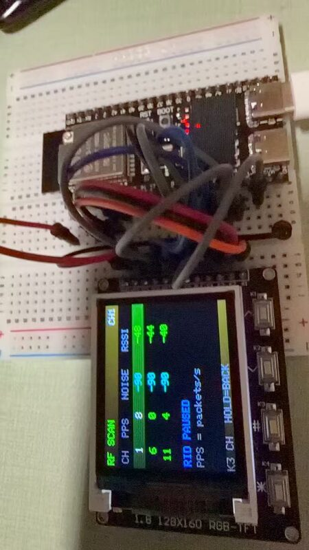

# ESP32-S3 + ST7735S 手持 Remote ID 扫描器

[](LICENSE)

被动接收无人机广播的 ASTM F3411 / OpenDroneID Remote ID（BLE + WiFi Beacon/NAN），
在 1.8" ST7735S 屏幕上列出无人机 ID、RSSI、经纬度、高度、速度和操作员位置。

> 只接收，不发射、不干扰。不同地区对无线电监测和隐私的规定不同，使用前请自行确认。



*RF SCAN 页面：ch1/6/11 的 PPS、噪声底、RSSI，按红黄绿显示强弱。*

## 支持的硬件

- **已验证**：ESP32-S3-DevKitC-1（双 USB-C、BOOT/RST、板载天线，16MB flash，无 PSRAM）
- **兼容**：其他 ESP32-S3 开发板，3.3V 逻辑、至少 10 个可用 GPIO、320KB RAM；引脚在 `include/config.h` 里改
- **屏幕**：ST7735S 128x160 SPI，8 针，3.3V；本机这块需要 `LCD_OFFSET_X=4, LCD_OFFSET_Y=0`，不同批次可能要 `(0,0)` 或 `(2,1)`
- **按键**：4 个独立轻触按键，一端接 GPIO、一端接 GND；K1/K2/K3 必需，K4 可选
- **不要用**：GPIO0/3/45/46（strapping）、GPIO19/20（USB）、GPIO26~37（flash/PSRAM，视模组而定）
- 本项目默认使用 GPIO4/5/6/14（按键）和 GPIO7~12（屏幕）

## 硬件

- ESP32-S3-DevKitC-1 公版（双 USB-C、BOOT/RST 两个按键、板载天线）
- ST7735S 1.8" 128x160 SPI 屏幕，带 4 个独立按键（K1~K4）
- 面包板 + 杜邦线

板子四角是 3 个 GND + 1 个 3V3，即标准 DevKitC-1 布局：
J1 排针 1 脚为 3V3，22 脚为 GND；J3 排针 1/21/22 脚为 GND。

## 接线

### 屏幕（先只接这一组）

| 屏幕丝印 | 常见别名 | ESP32-S3 | DevKitC-1 J1 脚位 |
|---|---|---|---|
| GND | G | GND | J1-22 |
| VCC | 3V3 | 3V3 | J1-1 或 J1-2 |
| SCL | SCK / CLK | GPIO12 | J1-18 |
| SDA | MOSI / DIN | GPIO11 | J1-17 |
| CS | | GPIO10 | J1-16 |
| DC | A0 / RS | GPIO9 | J1-15 |
| RES | RST | GPIO8 | J1-12 |
| BLK | LED / BL | 3V3（先这样接） | J1-1/2 |

注意：

- 屏幕的 `SDA` 是 SPI 的 MOSI，不是 I2C 数据线。
- 第一次点亮建议把 `BLK` 直接接 3V3，排除背光问题。确认能亮后，想调亮度再把
  `BLK` 改接 GPIO7（不能同时接 3V3 和 GPIO7）。
- 屏幕 VCC 先用 3V3，不要接 5V。多数模块 3.3V 就能正常工作和点亮背光。

### 4 个按键（屏幕点亮后再接）

每个按键一端接对应 GPIO，另一端接 GND。代码已开内部上拉，不需要外接电阻。

| 屏幕丝印 | 功能 | ESP32-S3 | J1 脚位 |
|---|---|---|---|
| K1 | UP / 上 | GPIO4 | J1-4 |
| K2 | DOWN / 下 | GPIO5 | J1-5 |
| K3 | OK / 确认 | GPIO6 | J1-6 |
| K4 | BACK / 返回 | GPIO14 | J1-20 |
| 公共端 | GND | GND | J1-22 |

如果模块的按键不是 K1~K4 四根独立线，而是只有一根 `KEY`/`ADC`，先停下，
那是电阻分压按键，需要改代码和接线。

## 软件

推荐 PlatformIO（VS Code 插件或命令行）。

```bash
cd esp32-rid-scanner

# 1) 先烧硬件测试固件：只验证屏幕和按键
pio run -e esp32s3-test -t upload
pio device monitor -e esp32s3-test

# 2) 硬件测试通过后，烧扫描器固件
pio run -e esp32s3 -t upload
pio device monitor -e esp32s3
```

串口 115200。板子有两个 USB-C：

- 标 `UART` / `COM` 的口走 CH340，最稳，建议刷机和看日志都用它；
- 标 `USB` 的口是芯片原生 USB，也可以刷机/看日志。

代码会同时往 UART0 和 USB-CDC 输出日志，两个口都能看到。

> 本仓库不提供预编译二进制，请按上面的 PlatformIO 命令自行编译烧录。

## 硬件测试固件行为

- 屏幕显示彩色条、引脚配置和 4 个按钮框；
- 按 K1/K2：调背光亮度；
- 按 K3：旋转屏幕 90°；
- 按 K4：反色；
- 按任一键时对应框高亮，串口打印按键事件。

屏幕白屏/花屏时依次检查：

1. GND、VCC 是否接对，3V3 与 GND 是否短路；
2. BLK 是否接 3V3（或 GPIO7），RES 是否接 GPIO8；
3. DC、CS 是否接反；
4. SPI 线是否太长/松动，可把 `display.h` 里的 `freq_write` 从 27MHz 降到 20MHz；
5. 图像整体偏移：改 `config.h` 的 `LCD_OFFSET_X/Y`，试 `(2,1)`、`(1,2)`；
6. 颜色反了：`LCD_INVERT` 改 1，或按 K4 反色。

## 扫描器固件行为

- **纯被动接收**：不连接 WiFi、不主动扫描、不发射；BLE 使用被动扫描，连 SCAN_REQ 都不发；
- BLE：监听 Service Data UUID `0xFFFA`，解析 OpenDroneID 单消息/消息包；
- WiFi：监听 2.4GHz 信道 6 的 Beacon / Probe Response 厂商 IE，以及 NAN Action 帧；
- 列表最多显示 16 架，30 秒无更新自动移除；
- K1/K2 选择目标；
- 列表页短按 K3 进详情；
- 详情页分三页：P1 显示 ID/位置/高度/速度，P2 显示操作员 ID/操作员位置/AGE/MAC，P3 显示 RF 状态；
- 详情页短按 K3 翻页，长按 K3 约 0.7 秒返回列表；
- 列表页长按 K3 进入 **RF SCAN**：自动轮询 ch1/6/11，显示每信道 PPS/NOISE/RSSI；
- RF SCAN 中短按 K3 手动换信道，长按 K3 退出并恢复 ch6；此模式会暂停 WiFi RID（BLE 继续）；
- K4 正常时也能直接返回；K4 不可用不影响使用；
- UI 使用 160x128 离屏 sprite 双缓冲，避免整屏刷新闪烁。
- 本机屏幕使用 `LCD_OFFSET_X=4, LCD_OFFSET_Y=0` 对齐。

## 空口噪声 / RF 状态

- 列表头右侧显示 `NF-xx`，是最近一次有效包携带的 WiFi 噪声底（dBm）；
- 详情 P3 显示 `CH / PPS / NOISE / RSSI / PKT / MGMT`；
- `PPS` 是当前信道每秒收到的 802.11 包数，可作为空口活动度参考；
- 颜色：RSSI 绿 ≥ -60、黄 -80~-60、红 < -80；噪声底 绿 ≤ -95、黄 -95~-85、红 > -85；
- `*` 标记：RSSI ≥ -50 dBm（能量强）、噪声底 > -85 dBm（干扰大）、PPS ≥ 100（空口忙）时，在数字后加 `*`；
- 完全收不到包时，NOISE 显示 `--`，因为 ESP32 的 `noise_floor` 是随包上报的 PHY 估计，不是独立频谱仪；
- 需要真正与包无关的噪声/频谱测量，要外加 RF 功率检波器或 SDR。

串口命令：`s` 状态、`w` WiFi/RF 统计、`r` 切换 RF SCAN；`d`/`c` 仅在 `esp32s3-demo` 环境可用。

ESP32-S3 只有 2.4GHz WiFi，收不到 5GHz 的 WiFi Remote ID，也收不到 5.8G 图传。
WiFi Beacon 方式的 RID 标准使用 **2.4GHz 信道 6**；BLE RID 使用广播信道 37/38/39，不是 ch6。
没有广播 Remote ID 的无人机不会出现。

## 相关工具（不在本仓库）

- ESP8266 WiFi RSSI/PPS 监视器：https://github.com/kaiwater/esp8266-wifi-monitor
- RID 测试发射端仅为本地调试工具，未发布。

## 参考项目

- Sky-Spy（最接近）：https://github.com/colonelpanichacks/Sky-Spy
- OpenDroneID 核心库：https://github.com/opendroneid/opendroneid-core-c
- ESP32 收发示例：https://github.com/sxjack/uav_electronic_ids
- ESP32 + 显示屏接收器：https://github.com/PeterJBurke/RID
- Linux 接收参考：https://github.com/sxjack/unix_rid_capture
- Android 接收参考：https://github.com/opendroneid/receiver-android

本项目的 OpenDroneID 解析文件来自 opendroneid-core-c / Sky-Spy，遵循 Apache-2.0。

## Changelog

版本历史和详细记录见 [`CHANGELOG.md`](CHANGELOG.md) 与 [`changelogs/`](changelogs/)。
